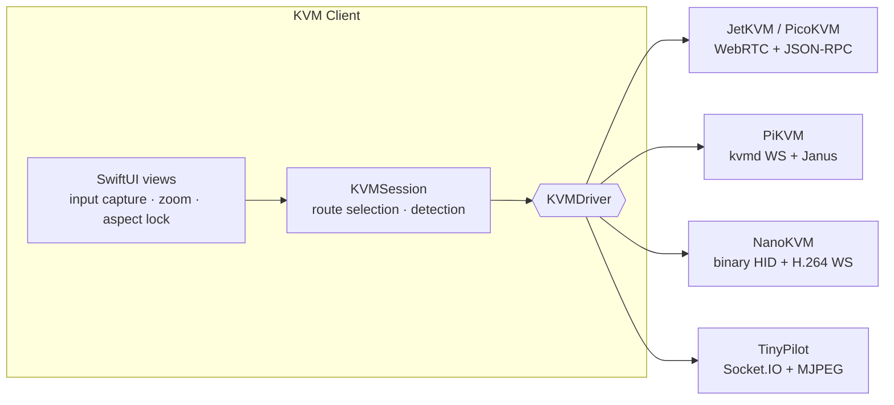

<div align="center">

<picture>
  <source media="(prefers-color-scheme: dark)" srcset="assets/logo-dark.svg">
  <source media="(prefers-color-scheme: light)" srcset="assets/logo-light.svg">
  
</picture>

# KVM Client

**A fast, fully native macOS, iPadOS and iOS client for open-source IP-KVMs.**<br>
JetKVM · Luckfox PicoKVM · PiKVM · NanoKVM · TinyPilot — one app, no browser tab.

[](#requirements)
[](#architecture)
[](#how-it-works)
[](LICENSE)
[](#contributing)

</div>

---

IP-KVMs give you the screen, keyboard and mouse of another computer over the network — BIOS included. Their web UIs are great, but a browser tab can't grab <kbd>⌘</kbd><kbd>Tab</kbd>, fights you over shortcuts, and feels clumsy on an iPhone.

**KVM Client talks to the devices directly**, in their own protocols, and gives you a real app: hardware-decoded video, every key captured, a window that is exactly the shape of the remote screen, and touch gestures designed for small screens.

## Highlights

<table>
<tr>
<td width="50%" valign="top">

### 🖥️ Feels like sitting in front of it
- **Hardware-decoded video** over WebRTC, raw H.264 (VideoToolbox) or MJPEG
- **Pixel-exact window** — the window locks to the remote resolution and aspect ratio, no black bars
- **Absolute pointer** mapped to the real picture, even when zoomed or letterboxed

</td>
<td width="50%" valign="top">

### ⌨️ Every key, every shortcut
- **<kbd>⌘</kbd><kbd>Tab</kbd>, <kbd>⌘</kbd><kbd>Space</kbd>, <kbd>⌘</kbd><kbd>Q</kbd>…** go to the remote machine, not macOS
- **Positional keys**: AZERTY, QWERTZ, Dvorak… the remote OS keeps its own layout
- **Apple ISO keyboards** handled (the `<>` / `@#` swap)
- <kbd>⌃</kbd><kbd>⌥</kbd><kbd>⌘</kbd> hands the keyboard back to your Mac

</td>
</tr>
<tr>
<td valign="top">

### 📱 Made for touch
- **Pinch to zoom** up to 6×, two-finger pan, two-finger double-tap to zoom
- **Tap to click, two-finger tap to right-click**, drag to drag
- **Virtual keyboard** with an extra-keys bar: Esc, Tab, sticky Ctrl/Alt/Win, arrows, F1–F12
- Hardware keyboards and iPad trackpads work natively

</td>
<td valign="top">

### 🌍 Anywhere, securely
- **Tailscale & ZeroTier**: addresses are learned from the device and tried automatically
- Picks the **fastest route** — local network first, then your overlay networks
- Passwords live in the **Keychain**; self-signed HTTPS is trusted per device only
- **Paste as keystrokes** in 20 PC keyboard layouts

</td>
</tr>
</table>

## Supported devices

| Device | Video | Keyboard & mouse | Status |
|---|---|---|---|
| **Luckfox PicoKVM** | WebRTC H.264 | JSON-RPC over data channel | ✅ Primary target |
| **JetKVM** | WebRTC H.264 (H.265 avoided) | JSON-RPC over data channel | 🧪 Implemented, needs testers |
| **PiKVM** · BliKVM · Geekworm | Janus H.264 → MJPEG fallback | kvmd WebSocket events | 🧪 Implemented, needs testers |
| **Sipeed NanoKVM** · NanoKVM-Pro | H.264 over WebSocket → MJPEG fallback | Binary HID reports | 🧪 Implemented, needs testers |
| **TinyPilot** | MJPEG or Janus H.264 | Socket.IO | 🧪 Implemented, needs testers |

The device type is **detected automatically** when you connect. Each driver was written from the device's open-source firmware and web UI. If you own one of the 🧪 devices, a quick report (even “it works!”) is hugely appreciated — [open an issue](../../issues).

## Gestures & shortcuts

| On macOS | | On iPhone / iPad | |
|---|---|---|---|
| Click the screen | Capture keyboard | Tap | Click |
| <kbd>⌃</kbd><kbd>⌥</kbd><kbd>⌘</kbd> | Release keyboard | Drag | Drag / select |
| Trackpad scroll | Mouse wheel | Two-finger tap | Right-click |
| Toolbar › Remote keyboard | Ctrl+Alt+Del, layouts, paste | Pinch | Zoom (up to 6×) |
| Toolbar › Capture ⌘ | Toggle shortcut capture | Two-finger drag | Pan while zoomed |
| | | Two-finger double-tap | Zoom in / fit |

## How it works



1. **Find the device** — every saved address (LAN, Tailscale, ZeroTier) is probed in parallel; the most preferred one that answers wins.
2. **Identify it** — cheap fingerprints (`/device/status`, `/api/auth/check`, `/api/vm/info`, `/api/status`) tell the firmware apart.
3. **Speak its protocol** — a `KVMDriver` handles login, video and HID. The rest of the app only sees normalized input (HID usages, a 0–32767 pointer, wheel notches) and a video feed.

## Requirements

- **macOS 14** Sonoma or later, **iOS / iPadOS 17** or later
- **Xcode 26** or later to build
- An IP-KVM reachable on your network (or through Tailscale / ZeroTier)

## Build from source

```bash
git clone https://github.com/dumanhaydar/kvmclient.git
cd kvmclient
open KVMUI.xcodeproj
```

Pick your team under **Signing & Capabilities**, choose *My Mac* or a device, and press <kbd>⌘</kbd><kbd>R</kbd>. Swift Package Manager fetches the only dependency, [stasel/WebRTC](https://github.com/stasel/WebRTC), on first build.

> [!NOTE]
> **Capturing <kbd>⌘</kbd><kbd>Tab</kbd> and <kbd>⌘</kbd><kbd>Space</kbd>** needs the *Accessibility* permission (System Settings › Privacy & Security › Accessibility). The app asks for it from the toolbar. Because it installs a system-wide keyboard tap while the remote screen has focus, the macOS app is not sandboxed.

## Project layout

```
KVMUI/
├── Core/        KVMSession, KVMDriver protocol, HTTP client, device detection
├── Drivers/     JetKVM · PiKVM · NanoKVM · TinyPilot, plus Janus, Socket.IO, WebSocket helpers
├── Video/       H.264 Annex B → CMSampleBuffer, MJPEG scanner, layer-backed renderer
├── Input/       HID mapping, keyboard layouts, macOS event tap, iOS virtual keyboard
├── Views/       SwiftUI screens, remote screen view, window aspect lock
└── Models/      Saved devices, Keychain
Tools/
├── generate-brand.swift            Renders the logo, app icons and artwork
└── generate-keyboard-layouts.py    Builds the typing tables from xkeyboard-config
```

## Roadmap

- [ ] Wake-on-LAN and ATX power controls (power, reset) where the device supports them
- [ ] Virtual media (mount ISO images)
- [ ] Audio
- [ ] Relative mouse mode for systems that ignore absolute pointers
- [ ] JetKVM binary HID channel (`hidrpc`) for even lower input latency
- [ ] Bonjour discovery of devices on the local network
- [ ] Multiple sessions in tabs / windows

## Contributing

Issues and pull requests are welcome! Adding a new KVM usually means one file: implement `KVMDriver` (`connect`, `disconnect`, keyboard reports, absolute pointer, wheel), add a `detect` fingerprint, and register it in `DeviceKind`. Shared building blocks — WebRTC, Janus, Socket.IO, MJPEG and H.264 decoding — are already there.

## Acknowledgements

KVM Client stands on the shoulders of the open-source KVM community:
[JetKVM](https://github.com/jetkvm/kvm) ·
[Luckfox](https://github.com/LuckfoxTECH) ·
[PiKVM](https://github.com/pikvm/kvmd) ·
[Sipeed NanoKVM](https://github.com/sipeed/NanoKVM) ·
[TinyPilot](https://github.com/tiny-pilot/tinypilot) ·
[uStreamer](https://github.com/pikvm/ustreamer) ·
[stasel/WebRTC](https://github.com/stasel/WebRTC).

*Not affiliated with any of the projects or companies above. All trademarks belong to their owners.*

## License

KVM Client is released under the [MIT License](LICENSE). Keyboard layout tables are generated from
[xkeyboard-config](https://gitlab.freedesktop.org/xkeyboard-config/xkeyboard-config); see
[THIRD_PARTY_NOTICES.md](THIRD_PARTY_NOTICES.md) for third-party licenses.
